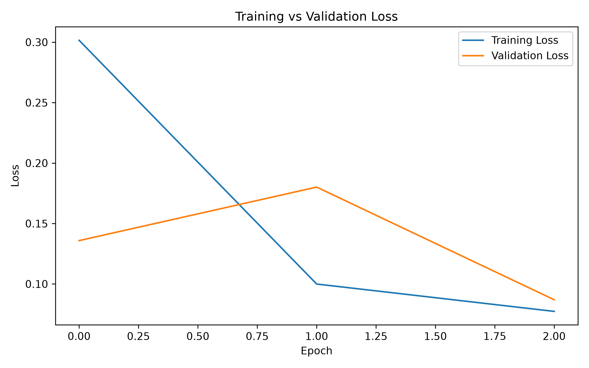
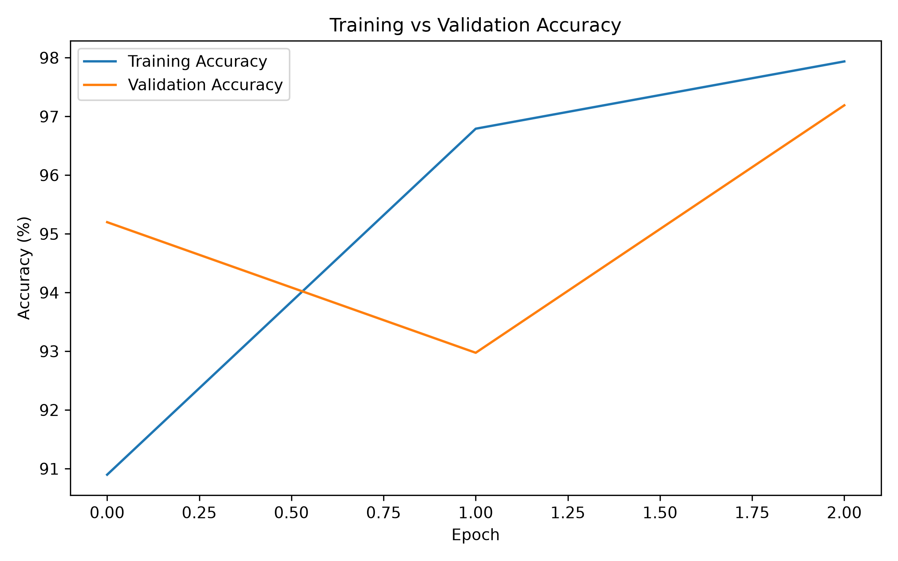
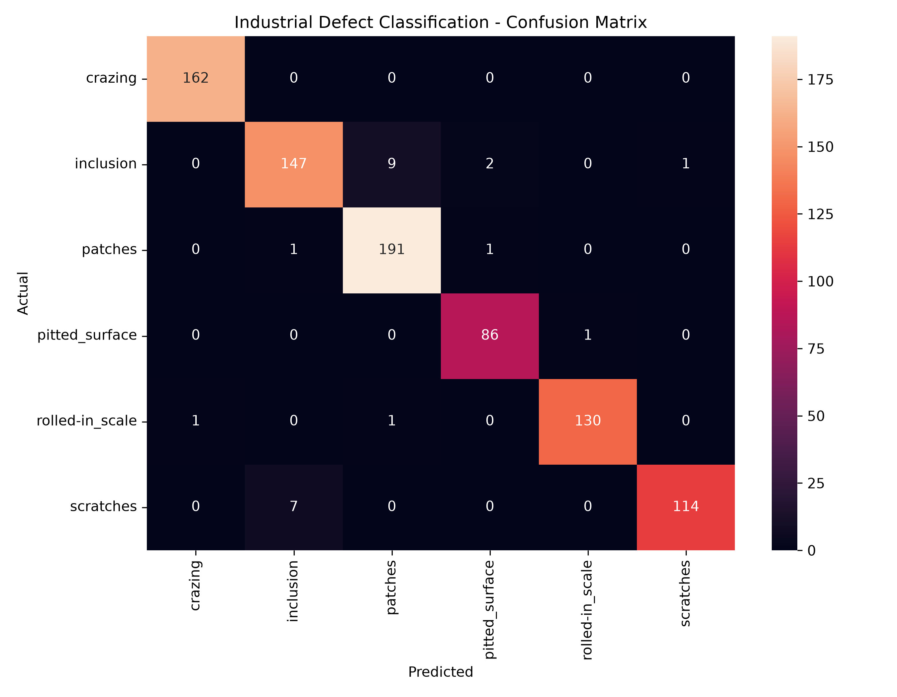

# Industrial Surface Defect Classification

A deep learning–based computer vision system for classifying industrial surface defects using **PyTorch and ResNet18 transfer learning**.

The project processes XML-based defect annotations, extracts annotated defect regions, trains a fine-tuned ResNet18 classifier, evaluates performance across six defect categories, and provides a Streamlit interface for inference.

---

## 🚀 Key Results

| Metric                    |     Result |
| ------------------------- | ---------: |
| Model                     |   ResNet18 |
| Framework                 |    PyTorch |
| Defect Classes            |          6 |
| Training Defect Regions   |      3,054 |
| Validation Defect Regions |        854 |
| Best Validation Accuracy  | **97.19%** |
| Macro F1-Score            | **97.25%** |
| Weighted F1-Score         | **97.18%** |
| CPU Inference Latency     | **~35 ms** |

---

## 📌 Problem Statement

Automated inspection is an important application of computer vision in manufacturing. Manual inspection of industrial surfaces can be time-consuming and susceptible to human inconsistency.

The objective of this project is to develop a deep learning model capable of classifying annotated industrial surface-defect regions into six defect categories.

The project focuses on **defect-region classification**, rather than object localization.

---

## 🧠 Defect Categories

The model classifies six types of surface defects:

* Crazing
* Inclusion
* Patches
* Pitted Surface
* Rolled-in Scale
* Scratches

---

## 🏗️ System Architecture

```text
NEU Surface Defect Dataset
            │
            ▼
     XML Annotations
            │
            ▼
    Bounding Box Extraction
            │
            ▼
       Defect Cropping
            │
            ▼
 Image Resize + Augmentation
            │
            ▼
      Pretrained ResNet18
            │
            ▼
     Transfer Learning
            │
            ▼
      Layer4 Fine-Tuning
            │
            ▼
      6-Class Prediction
            │
            ▼
   Confidence + Top-3 Results
            │
            ▼
      Streamlit Application
```

---

## 🔬 Methodology

### 1. Annotation Processing

The dataset contains XML annotations containing defect labels and bounding-box coordinates.

For each annotated object, the pipeline:

1. Parses the XML annotation.
2. Extracts the defect class.
3. Reads the bounding-box coordinates.
4. Locates the corresponding image.
5. Crops the annotated defect region.
6. Uses the resulting crop as a training sample.

This produced:

* **3,054 training defect regions**
* **854 validation defect regions**

---

### 2. Data Augmentation

Training images are augmented using:

* Random horizontal flipping
* Random rotation
* Brightness variation
* Contrast variation
* Image normalization

Validation images are resized and normalized without random augmentation.

---

## 🧠 Model Architecture

The project uses **ResNet18 pretrained on ImageNet**.

### Initial training

The pretrained backbone was frozen and a new classification head was added for the six defect classes.

```text
ImageNet-pretrained ResNet18
            ↓
      Frozen Backbone
            ↓
     New Linear Layer
            ↓
       6 Classes
```

### Fine-tuning

After establishing the baseline, the final ResNet block (`layer4`) was unfrozen and fine-tuned using a smaller learning rate.

This allows the model to adapt higher-level visual features from ImageNet to industrial surface-defect patterns while keeping computational requirements relatively low.

---

## ⚖️ Handling Class Imbalance

The training data contains different numbers of samples per defect category.

To reduce the effect of class imbalance, a **WeightedRandomSampler** was used during training.

Training distribution:

| Defect          | Samples |
| --------------- | ------: |
| Crazing         |     524 |
| Inclusion       |     852 |
| Patches         |     586 |
| Pitted Surface  |     169 |
| Rolled-in Scale |     496 |
| Scratches       |     427 |

---

## 📊 Results

### Classification Performance

| Defect          | Precision |  Recall |   F1-Score |
| --------------- | --------: | ------: | ---------: |
| Crazing         |    99.39% | 100.00% | **99.69%** |
| Inclusion       |    94.84% |  92.45% | **93.63%** |
| Patches         |    95.02% |  98.96% | **96.95%** |
| Pitted Surface  |    96.63% |  98.85% | **97.73%** |
| Rolled-in Scale |    99.24% |  98.48% | **98.86%** |
| Scratches       |    99.13% |  94.21% | **96.61%** |

Overall:

* Accuracy: **97.19%**
* Macro F1: **97.25%**
* Weighted F1: **97.18%**

---

## 📈 Training Results

### Training vs Validation Loss



### Training vs Validation Accuracy



### Confusion Matrix



---

## 🖥️ Streamlit Application

The project includes a Streamlit-based inference interface.

The application allows users to:

* Upload a defect-region image
* Generate a predicted defect class
* View prediction confidence
* View top-3 predictions
* Measure inference latency
* Inspect model information

Run the application with:

```bash
streamlit run app.py
```

The application will be available locally at:

```text
http://localhost:8501
```

---

## ⚡ Inference Performance

Inference was benchmarked on CPU.

Example inference:

```text
Prediction: scratches
Confidence: 97.21%
Inference Time: 34.86 ms
```

The relatively lightweight ResNet18 architecture makes the model suitable for experimentation with low-latency inference and potential deployment on accelerated hardware.

---

## 🛠️ Tech Stack

**Programming**

* Python

**Deep Learning**

* PyTorch
* Torchvision
* ResNet18
* Transfer Learning

**Computer Vision**

* Pillow
* OpenCV

**Data Processing**

* NumPy
* Pandas
* XML parsing

**Model Evaluation**

* Scikit-learn
* Confusion Matrix
* Precision
* Recall
* F1-Score

**Deployment**

* Streamlit

---

## 📁 Project Structure

```text
industrial-defect-detection/
│
├── src/
│   ├── train.py
│   └── predict.py
│
├── models/
│   └── defect_resnet18.pth
│
├── app.py
│
├── confusion_matrix.png
├── training_loss.png
├── training_accuracy.png
│
├── requirements.txt
├── .gitignore
└── README.md
```

The dataset is intentionally excluded from the repository because of its size. See the dataset section for setup instructions.

---

## ⚙️ Installation

Clone the repository:

```bash
git clone https://github.com/samshawarma/industrial-defect-detection.git
cd industrial-defect-detection
```

Create a virtual environment:

```bash
python -m venv venv
```

Activate it on Windows:

```bash
venv\Scripts\activate
```

Install dependencies:

```bash
pip install -r requirements.txt
```

---

## 📦 Dataset Setup

This project uses the **NEU Surface Defect Dataset**.

After downloading the dataset, place it under:

```text
data/
└── NEU-DET/
    ├── train/
    │   ├── annotations/
    │   └── images/
    │
    └── validation/
        ├── annotations/
        └── images/
```

The dataset itself is excluded from GitHub through `.gitignore`.

---

## 🏋️ Training

Update the dataset path in:

```text
src/train.py
```

Then run:

```bash
python src/train.py
```

The training pipeline automatically:

1. Parses XML annotations.
2. Extracts defect bounding boxes.
3. Creates defect-region samples.
4. Applies training augmentation.
5. Loads ImageNet-pretrained ResNet18.
6. Trains the classification head.
7. Fine-tunes the final ResNet block.
8. Evaluates the model.
9. Saves the best model checkpoint.
10. Generates training curves and a confusion matrix.

The trained model is saved to:

```text
models/defect_resnet18.pth
```

---

## 🔮 Future Improvements

Potential production-level extensions include:

* Object detection for automatic defect localization.
* YOLO/Faster R-CNN based detection pipeline.
* ONNX model export.
* Quantization for lower inference latency.
* GPU/accelerator benchmarking.
* Batch inference optimization.
* Model monitoring and drift detection.
* Explainability using Grad-CAM.
* Automated manufacturing-line camera integration.

---

## 🎯 Project Takeaways

This project demonstrates practical experience with:

* Deep learning
* Transfer learning
* Convolutional neural networks
* Computer vision
* XML annotation processing
* Data augmentation
* Class imbalance handling
* Model fine-tuning
* Performance evaluation
* PyTorch inference
* Streamlit deployment
* CPU inference benchmarking

---

## 👨‍💻 Author

**Soham Sharma**

Computer Science Engineering | Machine Learning & AI

GitHub: `https://github.com/samshawarma`

LinkedIn: `https://www.linkedin.com/in/soham-sharma-859320333`
